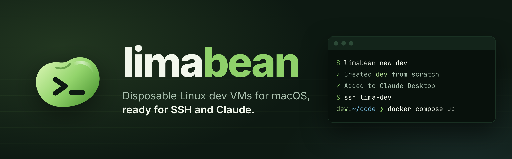
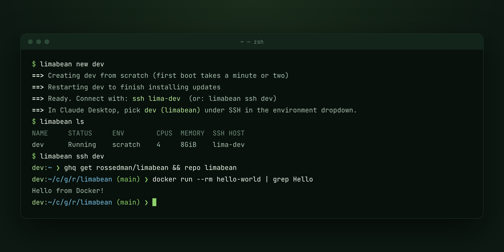
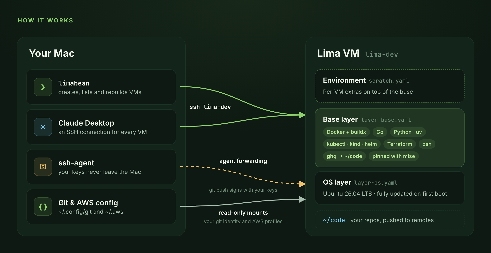

<p align="center">
  
</p>

<p align="center">
  <a href="https://github.com/rossedman/limabean/actions/workflows/lint.yml"></a>
  <a href="LICENSE"></a>
  
</p>

limabean creates disposable Ubuntu dev VMs on your Mac from layered
[Lima](https://lima-vm.io) templates. Each VM has a complete, version-pinned
toolchain and your git identity. It pushes with your SSH keys without ever
copying them in. Claude can drive it: through limabean's MCP server it
creates VMs, runs code in them and snapshots them, and every VM appears in
Claude Desktop as an SSH connection.

**Docs: [rossedman.github.io/limabean](https://rossedman.github.io/limabean/)**

- **One command per VM, ready as fast as it boots.** New VMs are APFS
  copies of a provisioned image, so `limabean up dev` only has to boot,
  and `limabean up` builds the VM a repository's `.limabean.yaml` describes;
  `limabean recipes` starts one for a Go service, a web app, a Claude
  sandbox and more.
- **Only what you need, in packs.** Every VM has Docker, Python and core CLI
  tools (ripgrep, fd, gh, …); Go, Node, Kubernetes, Terraform, Rust, Java, Ruby and more are
  packs you pick per VM or per project, every version pinned.
- **Keys stay on your Mac.** SSH keys stay in your agent, a scoped GitHub
  token lives in your Keychain, and your git and AWS config are mounted
  read-only.
- **Secrets without files.** API keys and tokens come from your Keychain,
  1Password, environment variables or commands, chosen when you create a VM.
- **Sandboxes for agents.** Limit a VM to the domains its work needs (learn
  mode records them for you) and lock it, so nothing inside, an agent
  included, can turn that off.
- **Claude drives it.** With [MCP](docs/mcp.md), Claude creates VMs, clones
  repositories, runs builds and tests, and snapshots VMs, all without touching
  your Mac. Every VM is also an SSH connection in Claude Desktop.
- **Safe to throw away.** `~/code` lives on its own disk, so `rebuild`
  keeps your repositories, and `rm` refuses to run while you have unpushed
  work. Clones take seconds, and `--ttl` or `run --rm` VMs delete
  themselves.
- **Plain Lima underneath.** Templates are ordinary YAML and shell, and
  `limactl` always works.

## Quick start

```bash
brew install rossedman/tap/limabean   # installs Lima too

limabean init       # save settings, fix ~/.ssh/config, check your setup

# optional: log VMs into GitHub for gh and the API (scoped tokens: docs/github.md)
gh auth token --hostname github.com | limabean github login --with-token

limabean up dev    # create a VM; a form asks which packs and secrets it gets
limabean ssh dev    # or: ssh lima-dev

cd ~/src/myapp && limabean up   # the VM a repository's .limabean.yaml describes
limabean recipes                # starter .limabean.yaml files: go-service, node-web, claude-agent, …
```

Upgrade with `brew upgrade limabean`. To install without the tap, get Lima
2.0 or newer first, then a binary from the
[releases page](https://github.com/rossedman/limabean/releases) or
`go install github.com/rossedman/limabean/cmd/limabean@latest`
([getting started](https://rossedman.github.io/limabean/getting-started/)).

## Use it with Claude

Add limabean's MCP server to Claude Code:

```bash
claude mcp add --scope user limabean -- limabean mcp
```

Then ask:

> Make a VM called scratch, clone owner/repo into it and get the tests passing.

Claude creates the VM, clones the repository, runs commands in it and can
snapshot it before risky changes. For an agent that should only reach certain
hosts, ask for a locked sandbox: *"create a locked VM that can only reach
github and python"*. Nothing runs on your Mac, Claude never sees secret values,
and deleting or restoring VMs needs `--allow-destructive`.

With a project's `.limabean.yaml`, Claude can plan and bring up its VM too;
you approve each `project_up`. The file can also turn on Claude Code plugins
in its VM, such as [guardrails](https://github.com/rossedman/guardrails) to
hold Claude to your standards, and the `claude-agent` recipe is a
locked-down sandbox to start from.

[Claude and MCP](docs/mcp.md) covers Claude Desktop, example prompts, every
tool and the safety model.

<p align="center">
  
</p>

## How it works

<p align="center">
  
</p>

## Commands

Leave out a VM name and you pick one from a list. Every command has
`--help` with examples, and the [CLI reference](docs/cli.md) has the details.

**Setup**

| Command | What it does |
|---|---|
| `limabean init` | Set up: git config, code directory, SSH `Include`, GitHub token; `--project` writes a repository's `.limabean.yaml` from what's in it |
| `limabean config` | Show every setting and where it comes from |
| `limabean doctor` | Check everything VMs depend on, and the project file you're in |
| `limabean bump` | Update the pinned tool versions in `templates/packs/*.toml` |

**VMs**

| Command | What it does |
|---|---|
| `limabean up [name]` | In a project: create its VM, or start it and apply the file's changes. With a name: start that VM, or create it, choosing packs and secrets (`--with go`) |
| `limabean ps` | Show the project's VM: status, `start`, ports and pending changes |
| `limabean logs [name]` | Show a VM's provisioning log, or its project's setup and start output (`-f` to follow) |
| `limabean down [name]` | Stop the project's VM, or the one named; `--idle 2h` stops every VM nobody is using |
| `limabean recipes [name]` | List starter `.limabean.yaml` files, or write one into a repository |
| `limabean run --rm -- <cmd>` | Run one command in a new VM, then delete it |
| `limabean packs` | List the tool packs a VM can get |
| `limabean ls` | List VMs, or print them as JSON with `--json` |
| `limabean ssh [name] [cmd]` | Open a shell or run a command, starting the VM if needed |
| `limabean get [name] <repo>` | Clone a repository into the VM with ghq |
| `limabean cp <src> <dst>` | Copy files between your Mac and a VM (`dev:path`) |
| `limabean code [name] [repo]` | Open the VM, or a repository in it, in VS Code, Cursor, Windsurf or VSCodium |
| `limabean ports [name]` | List the ports a VM forwards to your Mac |
| `limabean open [name] [port]` | Open a forwarded port in your browser |
| `limabean rebuild [name]` | Recreate a VM from the current templates, keeping `~/code` |
| `limabean clone <name> <new>` | Copy a VM, `~/code` and all, in seconds |
| `limabean rm [name]` | Delete a VM |
| `limabean snapshot save\|ls\|restore\|rm` | Save a VM, `~/code` included, and roll back to it later |
| `limabean images ls\|build\|prune` | The images new VMs are copied from, so they only have to boot |
| `limabean autostop on\|off\|status` | Stop idle VMs, and delete `--ttl` ones, in the background |

**Secrets and access**

| Command | What it does |
|---|---|
| `limabean secrets ls` | List secrets and where their values come from |
| `limabean secrets set NAME [ref]` | Add or change a secret (Keychain, 1Password, env var, command) |
| `limabean secrets rm NAME` | Remove a secret |
| `limabean secrets edit` | Edit a secrets file in your editor |
| `limabean secrets sync` | Install secrets in running VMs |
| `limabean github login` | Save a GitHub token for `gh`, the API and https pushes |
| `limabean github status` | Show the token's account and expiry, and which VMs have it |
| `limabean github sync` | Install the token in every running VM |
| `limabean github logout` | Remove the token from the Keychain and VMs |
| `limabean network ls\|allow\|rm\|open\|lock\|unlock` | Limit which domains a VM can reach, and lock it so that holds |
| `limabean network learn\|log` | Record what a VM reaches to build its allowlist, and see what was blocked |
| `limabean claude sync` | Register running VMs in Claude Desktop, remove the rest |
| `limabean mcp` | Let Claude create, run and snapshot VMs, as an MCP server ([details](docs/mcp.md)) |

**More**

| Command | What it does |
|---|---|
| `limabean completion <shell>` | Print a completion script for bash, zsh, fish or PowerShell |
| `limabean version` | Print the version (`--json` for scripts) |
| `limabean help --json` | Describe every command and flag as JSON, for scripts and agents |

## Documentation

The full docs are at **[rossedman.github.io/limabean](https://rossedman.github.io/limabean/)**,
built from the [`docs/`](docs) folder:

- [Getting started](docs/getting-started.md): install, requirements, first VM
- [Walkthrough](docs/walkthrough.md): Claude fixes a bug in a locked sandbox, start to finish
- [Claude and MCP](docs/mcp.md): let Claude create and drive VMs
- [Claude Desktop](docs/claude-desktop.md): how VMs become SSH connections
- [Sandboxes](docs/network.md): network allowlists, learn mode and locked VMs
- [Projects](docs/projects.md): `.limabean.yaml` and `limabean up`
- [Recipes](docs/recipes.md): starter project files for common kinds of VMs
- [Rebuilds, clones and snapshots](docs/lifecycle.md): throwaway VMs and autostop too
- [Inside a VM](docs/inside-a-vm.md): tools, Docker, shell, ports, paths
- [Secrets](docs/secrets.md): API keys and settings from the Keychain, 1Password and more
- [GitHub access](docs/github.md): a scoped token for `gh`, kept in your Keychain
- [CLI reference](docs/cli.md): every command and setting
- [Customizing](docs/customizing.md): templates, adding tools and environments
- [Troubleshooting](docs/troubleshooting.md)
- [Design notes](docs/design.md) and [the Go CLI's design](docs/go-cli.md)

## Contributing

Issues and pull requests are welcome; [CONTRIBUTING.md](CONTRIBUTING.md)
covers setting up, the checks CI runs and what a pull request needs. Every
pull request gets a snapshot build to try. Report security problems
privately, as [SECURITY.md](SECURITY.md) describes. Everyone taking part
follows the [code of conduct](CODE_OF_CONDUCT.md).

## License

[MIT](LICENSE)
